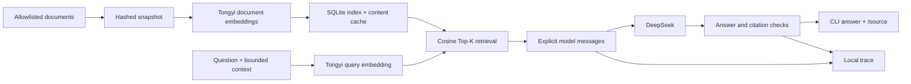

# Enterprise Knowledge Assistant

[](https://github.com/wyou0410/enterprise-knowledge-assistant/actions/workflows/tests.yml)
[](LICENSE)

A small, traceable RAG assistant for onboarding and process documentation. Ask a question in a terminal, inspect the retrieved evidence, and keep a local record of what the model actually received.

**Python CLI · SQLite vectors · DeepSeek chat · Tongyi embeddings**

[中文说明](docs/README.zh-CN.md) · [Live setup](docs/SETUP.md) · [Architecture](docs/ARCHITECTURE.md) · [Evaluation](docs/EVALUATION.md)

## What it does

Onboarding guidance often spans several pages, while an answer may depend on role, scope, or exceptions. This project connects questions to versioned document passages and exposes those passages through citations rather than relying on model memory alone.

- Answers Chinese and English questions through a simple conversational CLI.
- Shows the exact cited passage with `/source 1` and resets context with `/new`.
- Builds a local SQLite vector index from a hashed document snapshot; no database server or Dify instance is required.
- Records retrieval, actual model messages, citations, configuration hashes, usage, and errors locally.
- Checks that cited chunk IDs were actually sent to the model and derives source links from stored provenance.
- Provides automated evaluation, configuration freeze/resume checks, and holdout exposure tracking.

This is a learning and research prototype. It is not an official GitLab service or a production enterprise policy system. A valid citation identifies a passage; it does not prove that the answer interprets it correctly.

## Quick start — no API key required

Requirements: **Python 3.11 or 3.12**, Git, and [uv](https://docs.astral.sh/uv/getting-started/installation/).

```bash
git clone https://github.com/wyou0410/enterprise-knowledge-assistant.git
cd enterprise-knowledge-assistant
uv sync --locked --extra test
uv run --locked knowledge-assistant chat
```

Try these questions:

```text
What happens on the first day?
/source 1
如何申请电脑？
我是员工
电脑多久送到？
/new
/exit
```

The default **demo / MOCK** mode uses two original fictional documents, deterministic keyword matching, and scripted answers. It makes no embedding or chat API calls. It demonstrates the interface, citations, clarification, follow-up, and missing-evidence behavior; it does not measure a language model. Dependency installation may require network access.

An actual demo transcript is included in [docs/examples/demo.txt](docs/examples/demo.txt).

| Command | Action |
| --- | --- |
| `/source 1` | Print citation 1 from the most recent answer, including its passage, URL, and snapshot. |
| `/new` | Clear the in-memory conversation and citations. |
| `/help` | Show commands and mode information. |
| `/exit` | Exit; EOF also exits normally. |

## Live RAG mode

Live mode uses **Tongyi query/document embeddings → local cosine retrieval → DeepSeek → citation validation**. It requires your own authorized credentials, network access, available quota, and a local document snapshot. It never silently falls back to MOCK.

1. Copy `.env.example` to `.env` and configure your keys locally.
2. Set the API models, account/region-specific embedding URL, and local snapshot ID in `configs/native-baseline.yaml`.
3. Acquire documents you are permitted to use, validate them, and create a hashed snapshot.
4. Build the index and start chatting:

```bash
uv run --locked knowledge-assistant build-index --config configs/native-baseline.yaml --env-file .env
uv run --locked knowledge-assistant chat --mode live --config configs/native-baseline.yaml --env-file .env
```

See [the complete setup guide](docs/SETUP.md) for the document pipeline and configuration. Real document bodies, existing account IDs, API keys, vectors, and model request logs are **not shipped**. The included GitLab URL whitelist is a source-acquisition configuration, not a license grant or a frozen data bundle. A fresh download creates a new snapshot and does not reproduce an older experiment exactly.

## How it works



Baseline retrieval uses Top-K=3 without a reranker. The alternative configuration changes only Top-K to 5. Document passages are treated as untrusted data in the prompt; prior generated answers are not factual evidence. Only HTTP 429 receives bounded retries. Timeout, connection failure, and 5xx responses are not automatically repeated because request completion may be unknown.

See [architecture and implementation decisions](docs/ARCHITECTURE.md).

## Tests and automated evaluation

```bash
uv run --locked --extra test pytest -q
uv run --locked knowledge-assistant evaluate --version native-baseline --mode mock --run-id demo-check
uv run --locked knowledge-assistant report --run-dir evaluations/runs/demo-check
```

Use a new run ID for a new experiment. `--resume` accepts an existing run only when its recorded experiment identity still matches. The public CI matrix checks Windows/Linux and Python 3.11/3.12 using synthetic data and mocked transports; it does not use paid providers or the holdout set.

The current version **omits human answer scoring**. Automated reports measure engineering failures, latency, and reference-document coverage. Answer correctness and factual support remain unverified, rather than being inferred from citation presence or retrieval coverage.

### Recorded live development experiment

Both runs used the same frozen corpus, question set, prompt, model settings, and implementation. Each ran 30 development questions / 35 turns. Only Top-K changed.

| Automatically measured result | Top-K=3 baseline | Top-K=5 candidate |
| --- | ---: | ---: |
| Questions with an engineering/response validation error | 1/30 | 0/30 |
| Any reference document retrieved | 24/25 | 24/25 |
| All reference documents retrieved | 19/25 | 21/25 |
| All reference documents retrieved for multi-document questions | 2/7 | 4/7 |

Coverage uses the union of recorded retrieval traces across a question's turns. Twenty-five questions had reference document IDs; seven required multiple documents. These are document-level checks, **not answer accuracy or factual-support scores**. The experiment has not undergone human answer scoring or a formal holdout run. Remote model variability limits causal conclusions from one pair of runs.

The sanitized aggregate results and their provenance boundaries are in [docs/EVALUATION.md](docs/EVALUATION.md) and [evaluations/results/dev-summary.json](evaluations/results/dev-summary.json). Raw real-data runs are excluded from this public release.

## Repository structure

```text
src/knowledge_assistant/   CLI, chat, providers, indexing, data and evaluation
configs/                  Account-free native configs and fixed source whitelist
prompts/                  Explicit grounded-answer contract
evaluations/              Original synthetic cases and sanitized aggregate evidence
tests/                    Offline regression tests and synthetic fixtures
docs/                     Setup, architecture, evaluation and actual demo transcript
.github/                  Synthetic cross-platform CI and contribution templates
```

The package retains regression-tested compatibility helpers from an earlier adapter. The public CLI and all documented commands use the native backend; no Dify account or exported workflow is needed.

## Limitations and scope

- Retrieved text can be incomplete, outdated, or misinterpreted. Citation checks cannot establish semantic correctness.
- Real-corpus exact replay requires a legally shareable frozen data bundle; this repository guarantees only the shipped synthetic engineering workflow.
- Live mode sends questions and selected passages to configured providers. Inspect their terms before using sensitive material. Local traces also contain questions and passages.
- No web UI, autonomous tools, approval execution, authentication system, streaming interface, or local LLM is included.

## Contributing, security and license

See [CONTRIBUTING.md](CONTRIBUTING.md), [SECURITY.md](SECURITY.md), and [CODE_OF_CONDUCT.md](CODE_OF_CONDUCT.md). Open a GitHub issue for a reproducible bug or a focused proposal. Do not attach credentials, private traces, or document bundles with unclear redistribution rights.

Original code, documentation, and fictional demo fixtures are released under [MIT](LICENSE). Third-party documents and services retain their own terms; see [data and third-party notices](docs/DATA_AND_LICENSE.md). Development used AI assistance for code, tests, and documentation; see [project provenance](docs/PROVENANCE.md).
